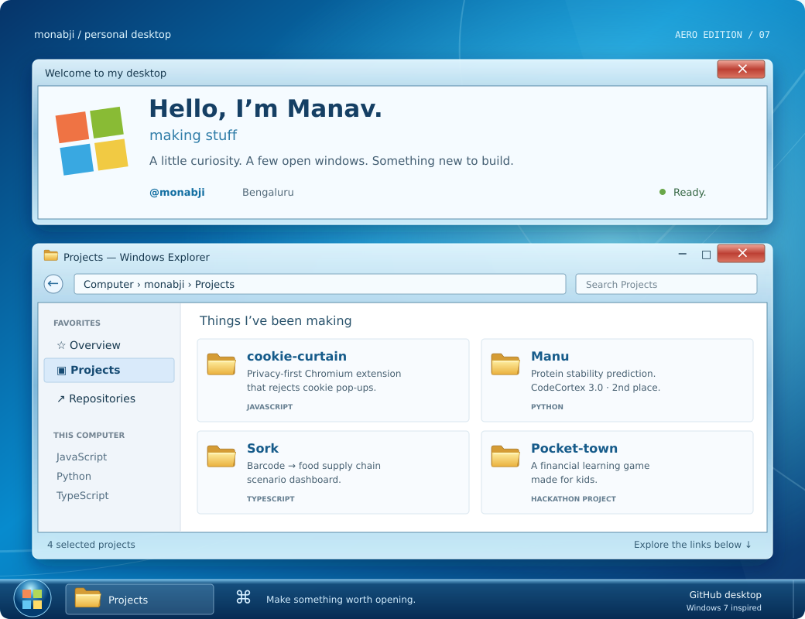

<!-- Windows 7 / Aero profile for @monabji. Keep assets/ beside this file. -->
<p align="center">
  
</p>

<p align="center">
  <a href="https://github.com/monabji?tab=repositories">📁 All repositories</a>
  &nbsp; · &nbsp;
  <a href="https://github.com/monabji?tab=stars">⭐ Favorites</a>
  &nbsp; · &nbsp;
  <a href="https://github.com/monabji?tab=overview">🖥️ Desktop</a>
</p>

### 📂 Open a project

| Application | What’s inside |
| :--- | :--- |
| [📁 cookie-curtain](https://github.com/monabji/cookie-curtain) | A privacy-first Chromium extension that automatically rejects cookie consent pop-ups. |
| [🧬 Manu](https://github.com/monabji/Manu) | Protein stability prediction from sequence and mutation. Built at CodeCortex 3.0 — **2nd place**. |
| [🔎 Sork](https://github.com/monabji/Sork) | An EAN-13 barcode to food supply chain scenario dashboard. Built during NutriHack. |
| [🏘️ Pocket-town](https://github.com/monabji/Pocket-town) | A financial learning game for kids. Built during the IIIT Hyderabad Megathon × Singularity hackathon. |

<details>
<summary>🖥️ Computer → Properties</summary>

<br />

```ini
[user]
name = Manav
username = monabji
location = Bengaluru
bio = making stuff

[personalization]
theme = Windows 7 Aero
accent = Glass blue
wallpaper = A little nostalgia

[workspace]
languages = JavaScript, Python, TypeScript
folders = browser extensions, experiments, hackathon builds
```

</details>

<p align="center"><sub>✦ Thanks for stopping by. You can leave the windows open.</sub></p>
