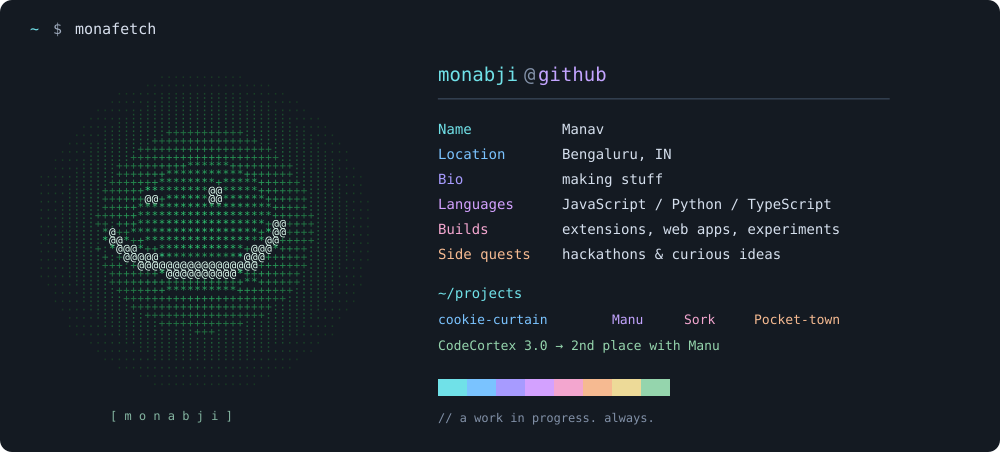

  

  <a href="https://github.com/monabji?tab=repositories">all repositories ↗</a>
  &nbsp; / &nbsp;
  <a href="https://github.com/monabji?tab=stars">starred finds ↗</a>

#### ~/projects

| project | a little context |
| :--- | :--- |
| [cookie-curtain ↗](https://github.com/monabji/cookie-curtain) | Less clicking “reject cookies.” More browsing. A privacy-first Chromium extension. |
| [Manu ↗](https://github.com/monabji/Manu) | Predicting protein stability changes. **2nd place at CodeCortex 3.0.** |
| [Sork ↗](https://github.com/monabji/Sork) | A barcode to food supply chain scenario dashboard, built during NutriHack. |
| [Pocket-town ↗](https://github.com/monabji/Pocket-town) | A financial learning game for kids, built at a hackathon. |
